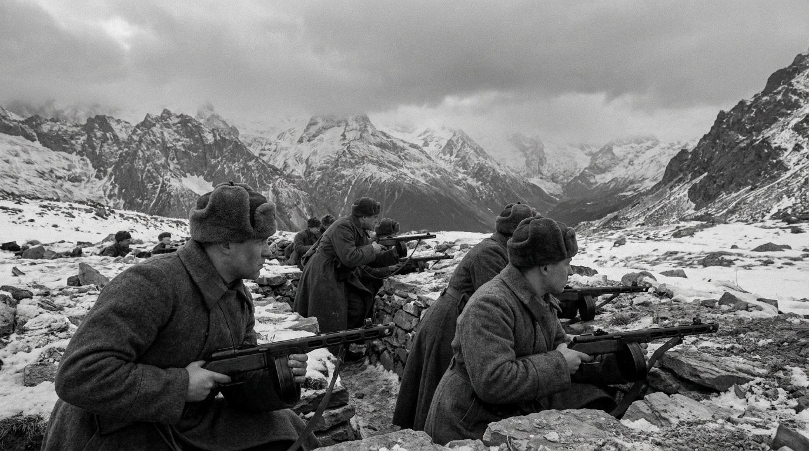
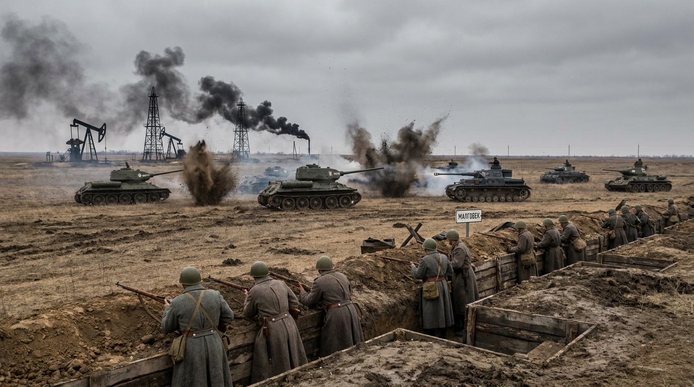
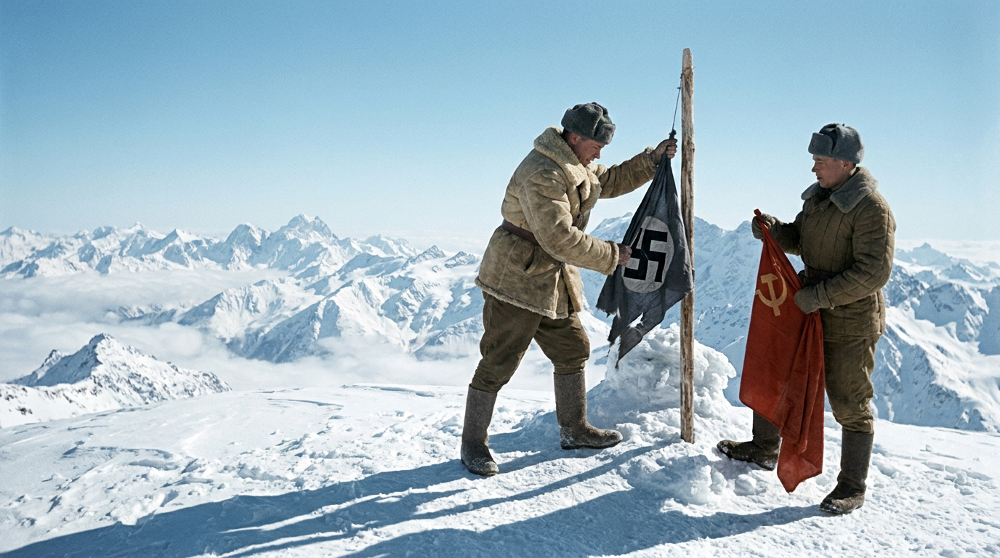
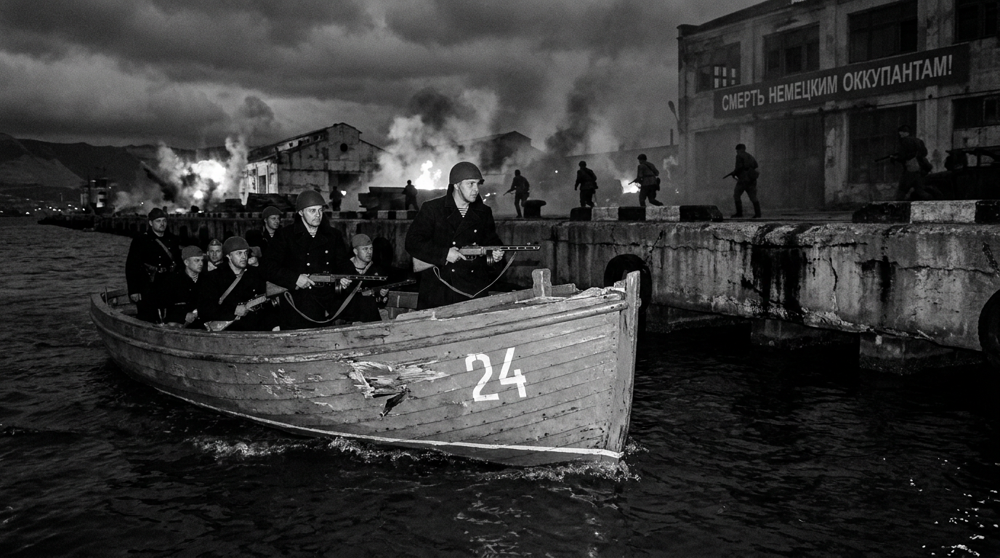

+++
title = 'Битва за Кавказ: как 442 дня сражений сорвали планы Гитлера на нефть'
date = 2026-10-10
draft = false
+++

Битва за Кавказ: 442 дня мужества и крах операции «Эдельвейс»

25 июля 1942 года началось одно из самых продолжительных сражений ВОВ. Как Красная армия остановила вермахт на пути к нефти Баку и Грозного. Хронология, факты, итоги.

Битва за Кавказ: как 442 дня сражений сорвали планы Гитлера на нефть

25 июля 1942 года. Немецкие горные стрелки с эдельвейсами на рукавах рвутся к Главному Кавказскому хребту. За ними — танки, за ними — нефтяные компании, готовые начать добычу. Гитлер называл Кавказ главной целью летней кампании. Но то, что должно было стать триумфом вермахта, обернулось вторым по продолжительности сражением Великой Отечественной войны — 442 дня, которые изменили ход истории.

Почему Кавказ был жизненно важен для Германии

Кавказ — это не просто территория. Это нефть. До войны Баку и Грозный давали более 90% всей советской нефти. Захват этих месторождений означал бы для Германии решение топливной проблемы, а для СССР — паралич армии и промышленности.

Но были и другие цели. Геббельс говорил: «Кто обладает пшеницей, нефтью, железом и углём — тот выиграет войну». Кубань и Ставрополье — житницы страны. Выход к Чёрному морю. Контроль над ленд-лизом через Иран. И, наконец, втягивание Турции в войну на стороне Оси.

План «Эдельвейс»: как вермахт собирался покорить Кавказ

Немецкое командование разработало операцию под кодовым названием «Эдельвейс» — в честь горного цветка, символа альпийских стрелков. План был дерзким: обойти Главный Кавказский хребет с запада, захватив Новороссийск и Туапсе, и с востока — ворвавшись в Грозный и Баку.

Гитлер лично говорил: «Решающим для нас является прорыв на Туапсе, а затем блокирование Военно-Грузинской дороги и прорыв к Каспийскому морю». После захвата Северного Кавказа немцы планировали преодолеть хребет в центральной части по перевалам и выйти в районы Тбилиси, Кутаиси и Сухуми.

Оборона: 442 дня, которые остановили вермахт

Битва за Кавказ разделяется на два этапа: оборонительный (25 июля — 31 декабря 1942) и наступательный (1 января — 9 октября 1943).

В первые месяцы ситуация была катастрофической. В результате просчётов Генерального штаба оборона Кавказа с севера практически отсутствовала. Немцы быстро захватили Ставрополь, Армавир, Майкоп, Краснодар, Элисту. В конце августа части вермахта ворвались в Моздок — возникла угроза Грозному.

Но затем произошло то, что немцы не предусмотрели. Мужество защитников перевалов, героизм под Орджоникидзе, упорство в Малгобеке — всё это сорвало планы вермахта.

Малгобек: четыре месяца, которые спасли нефть

Малгобек — маленький город в Ингушетии, который стал одним из главных узлов сопротивления на нефтяном направлении. Гитлер приказал захватить его любой ценой, ведь вместе с месторождениями Баку Малгобек давал большую часть советской нефти.

3 сентября 1942 года немцы начали штурм. За ними двигались тысячи специалистов: нефтяники, инженеры, техники — после захвата они должны были сразу запустить добычу для нужд вермахта. Четыре месяца шли ожесточённые бои. Малгобек 14 раз переходил из рук в руки. В боях за город погибло более 120 тысяч советских солдат.

И немцы не прошли.

Перелом: от обороны к наступлению

Победа под Сталинградом создала условия для контрнаступления на Кавказе. С января 1943 года Красная армия начала масштабное наступление. События развивались стремительно:

- 3 января — освобождён Моздок
- 11 января — Пятигорск
- 17 января — Черкесск
- 21 января — Ставрополь
- 28 января — Майкоп
- 12 февраля — Краснодар

С вершины Эльбруса был сброшен фашистский флаг. Советские войска прошли с боями до 600 километров, освободив огромную территорию.

«Голубая линия» и завершение битвы

К весне 1943 года немецкие войска отошли на заранее подготовленный оборонительный рубеж — «Голубую линию» на Таманском полуострове. Это была мощная система укреплений, прикрывавшая подходы к Крыму.

10 сентября 1943 года началась Новороссийско-Таманская наступательная операция. В ночь на 10 сентября в Новороссийском порту был высажен десант. Одновременно началось наступление на суше. 16 сентября Новороссийск был освобождён.

9 октября 1943 года завершилась Новороссийско-Таманская операция. Таманский полуостров был полностью освобождён. Битва за Кавказ — 442 дня — закончилась.

Итоги: что дала победа на Кавказе

Победа имела огромное военно-политическое и экономическое значение. Советский Союз сохранил контроль над важнейшим нефтедобывающим регионом. Немецкий план «Эдельвейс» провалился полностью.

Поворотным моментом стала победа под Сталинградом, но битва за Кавказ стала важнейшим этапом коренного перелома в войне. Медалью «За оборону Кавказа» были награждены около 870 тысяч человек.

Заключение: 

Битва за Кавказ — это не просто страница истории. Это 442 дня, когда решалась судьба страны. Это солдаты, которые стояли насмерть на перевалах. Это нефтяники, которые консервировали скважины, чтобы они не достались врагу. Это память, которую мы обязаны сохранить.