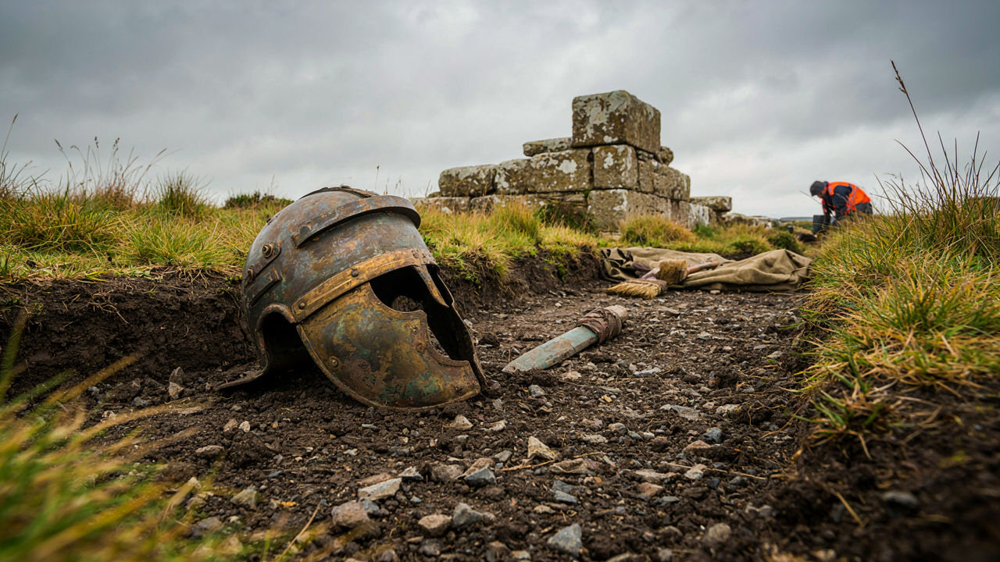

+++
title = 'Тайна IX Испанского легиона: 5000 римских солдат исчезли без следа'
date = 2026-10-09
draft = false
+++

Тайна IX Испанского легиона: 5000 римских солдат исчезли без следа
Представьте: 5000 лучших воинов Римской империи, закалённых в боях, бесследно исчезают. Ни тел, ни оружия, ни упоминаний в хрониках. Только глухое молчание. Это не сюжет фэнтези — это реальная историческая загадка, которая уже 2000 лет не даёт покоя учёным.

IX Испанский легион был одним из самых доблестных подразделений Рима. Он участвовал в завоевании Британии, подавлял восстание Боудикки, строил крепости. Но после II века нашей эры его следы теряются. Что произошло с легионом? Куда исчезли тысячи солдат? Ответов нет до сих пор.

Легенда, которая пугает историков
В 108 году н. э. легион дислоцировался в Эборакуме (современный Йорк). Последнее упоминание о нём встречается в римских записях примерно в 120 году. Затем — тишина. Ни один античный автор больше не говорит о IX легионе. Это странно: римляне вели подробные хроники, фиксировали каждое подразделение. А тут — целый легион исчез.

Теория 1: Уничтожен в Шотландии
Самая популярная версия: легион был разгромлен пиктами во время похода на север Британии. Якобы римляне углубились в шотландские леса, где попали в засаду. Но археологи не нашли ни массовых захоронений, ни римского оружия в тех местах. Более того, Рим обычно мстил за такие поражения, а здесь — никаких ответных походов.

Это первая картинка:

Теория 2: Переброшен в Армению
Некоторые историки считают, что легион перевели на восток — в Армению, где шли войны с Парфией. Но в списках легионов, расквартированных там, IX Испанский не значится. И почему нет записей о передислокации?

Теория 3: Миф и вымысел
Есть мнение, что легион никогда не исчезал — просто его расформировали, а солдат распределили по другим подразделениям. Но тогда почему античные авторы молчат? И почему археологи находят следы IX легиона в разных уголках Европы?

Теория 4: Ушёл в Китай?
Самая смелая гипотеза: остатки легиона после поражения в Парфии попали в плен и были отправлены на восток. Якобы они дошли до Китая и даже основали город Лицзянь. Эта версия будоражит умы, но подтверждений ей нет.

Развязка: что мы знаем точно
До сих пор нет ни одного доказательства гибели легиона. В 2011 году археологи нашли в Шотландии римский лагерь, который мог принадлежать IX легиону, но это лишь косвенная улика. Тайна остаётся нераскрытой.

А как вы думаете, что случилось с IX Испанским легионом? Напишите в комментариях! И читайте другие загадки истории на нашем сайте — «Тайна библиотеки Ивана Грозного» и «Кто построил Стоунхендж?».

А это вторая:
